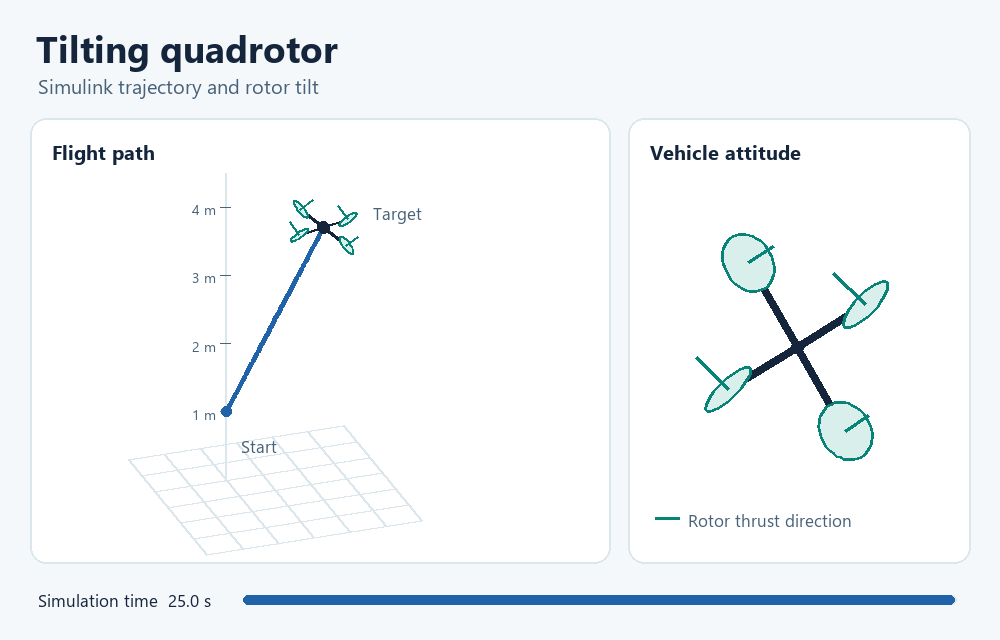
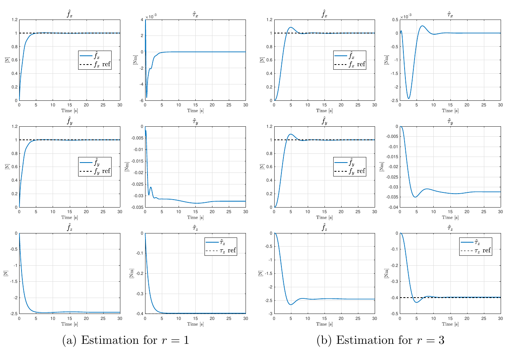

# Multirotor Flight Control & Disturbance Estimation

*Field and Service Robotics · University of Naples Federico II · 2024–2025*

## Overview

A multirotor study combining external force and torque estimation with two simulated flight controllers. The report also derives the control allocation matrix for a coplanar octocopter and discusses flight near the ground and ceiling.

## My contribution

- Implemented a momentum-based disturbance estimator for the supplied flight data. Derived the gains from a Butterworth filter and compared estimator orders **1, 3, 5, and 9**.
- Completed the outer position loop and the inner attitude loop of the supplied geometric control template. The controller computes total thrust and body torques using rotation matrices.
- Implemented a PD controller with feedforward for the supplied Voliro-style tilting quadrotor template. Used pseudoinverse allocation to convert the requested forces and torques into commands for the four tilting rotors.

## Tools

MATLAB, Simulink, Signal Processing Toolbox, Robotics System Toolbox, and UAV Toolbox.

## Run

- **Task 3.** Run `main_es_3` from `Task 3` to estimate disturbances using the included flight data.
- **Task 4.** Run `main_4_plot` from `Task 4` to simulate the geometric controller.
- **Task 5.** Run `main_plot_5` from `Task 5` to simulate the tilting-rotor controller. Each script exports its plots to a `figures` folder.

## Key results

- The estimator recovered the applied **1 N** forces along both horizontal axes and the **−0.4 N·m** yaw torque. The vertical force estimate implied a mass of about **1.25 kg** from a nominal **1.5 kg**.
- The geometric controller tracked the position and yaw maneuver and settled into hover at the target pose.
- The tilting quadrotor tracked simultaneous translation and rotation, then held its final pose at **45° roll**, **45° pitch**, and **180° yaw** in simulation.

## Simulation results

[Watch the 12-second simulation replay (MP4)](assets/tilting-quadrotor.mp4). The animation uses the model's logged position, attitude, and rotor tilt. The [initial and final poses from the report](assets/tilting-quadrotor-poses.png) show the same maneuver in the original UAV visualization.

## Project files

- [Technical report](multirotor-flight-control-and-disturbance-estimation.pdf), including the analysis in Tasks 1 and 2
- [Task 3 · Momentum-based estimator](Task%203/main_es_3.m) · [Flight data](Task%203/flight-data.mat)
- [Task 4 · Geometric control script](Task%204/main_4_plot.m) · [Simulink model](Task%204/geometric_control_template.slx)
- [Task 5 · Tilting-rotor control script](Task%205/main_plot_5.m) · [Simulink model](Task%205/tilting_control_voliro_template.slx)
